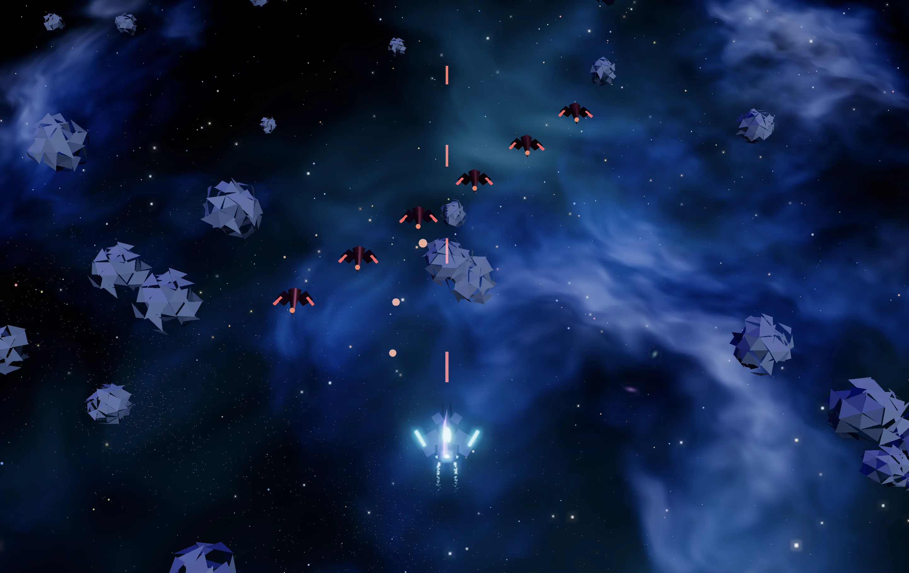
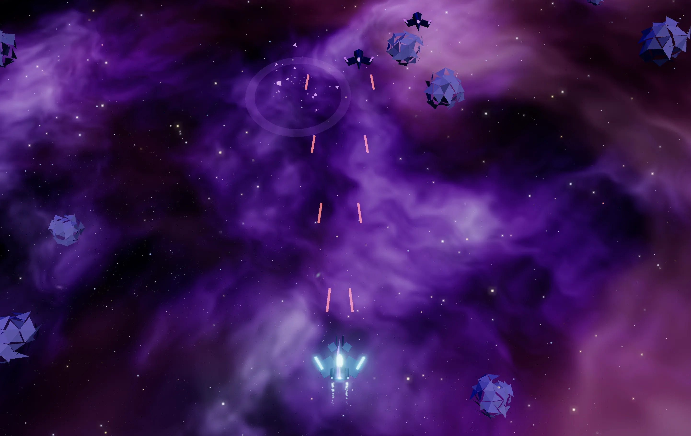

# Space Raiden 3D · 星际雷电

经典雷电纵向卷轴 × 全 3D 画面的太空射击游戏。纯 Three.js 打造，所有模型与音效均为程序化生成，零外部资源依赖。

> **在线试玩 / Play online**：<https://wangjunjian.com/space-raiden-3d/> — 打开即玩、零安装。桌面端用键盘，移动端触屏拖动、点击开始。
>
> **备用地址 / Fallback**：<https://wang-junjian.github.io/space-raiden-3d/>（GitHub Pages 官方入口，会自动 301 跳转到上面的自定义域；主站域名变更时仍可访问）。

公元 2249 年，外星机械军团「湮灭舰队」入侵人类深空殖民地。驾驶最新型战机「雷电-X」，穿越碎石星环与幽灵星云，直捣湮灭母舰。






## 运行

```bash
npm install
npm run dev      # 开发模式（默认 http://localhost:5173）
npm run build    # 产出静态文件到 dist/
npm run preview  # 预览构建产物
```

## 构建与部署

本仓库**只提交源码**：`dist/` 在 `.gitignore` 中，clone 后跑 `npm install && npm run build` 即可得到完整可玩站点。

线上试玩页由 `.github/workflows/pages.yml` 在 push 到 `main` 时自动构建并发布，也可在 Actions 里手动 `workflow_dispatch` 重跑：

```
npm ci → npm run build → 构建可复现性检查（两次构建 SHA256 必须一致，且 build 不得改动任何被跟踪文件）
       → 组装 site/（dist 全量 + .nojekyll）→ upload-pages-artifact → deploy-pages
```

自定义域来自用户站点仓库 `wang-junjian/wang-junjian.github.io` 已绑定的 `wangjunjian.com`：本仓库启用 Pages 后，项目站点自动挂到该域的 `/space-raiden-3d/` 路径下，所以 `wang-junjian.github.io/space-raiden-3d/` 会 301 跳转到这里。两个入口返回同一份产物，本仓库不配置 CNAME、不改动域名或 DNS。

`vite.config.js` 把 `base` 设为 `./`：Pages 项目站点挂在子路径下，Vite 默认的绝对路径 `/assets/...` 在子路径下会 404。

## 操作

| 按键 | 功能 |
|---|---|
| WASD / 方向键 | 移动 |
| （自动射击） | 武器持续开火 |
| B / 空格 | 炸弹（清屏弹幕 + 全屏伤害） |
| P / ESC | 暂停 |
| ENTER / 点击 | 确认 / 开始 |

移动端：触屏拖动移动，点击开始。

## 玩法

- **三大关卡**：碎石星环（小行星带）→ 幽灵星云（离子风暴）→ 湮灭母舰（甲板网格），每关末尾有多阶段 Boss 战
- **双武器系统**：红色「火神炮」扇形范围输出 / 蓝色「激光」穿透高伤，各 1–5 级，拾取同色能量体升级
- **道具**：P 火力提升、R/L 武器切换、B 炸弹、S 能量护盾、1UP 奖命、◆ 勋章加分
- **敌机 5 种**：侦察机 / 截击机（正弦机动）/ 炮艇（悬停炮击）/ 轰炸机（环形弹幕）/ 精英机（侧翼突袭）
- **Boss**：哨戒巡洋舰（可破坏双炮塔）→ 虚空拦截者（螺旋弹幕）→ 湮灭核心（三阶段最终形态）
- 死亡掉一级火力；通关保留武器与分数，挑战最高分（localStorage 持久化）

## 技术要点

- **Three.js + Vite**，UnrealBloomPass 泛光后期，ACES 色调映射
- **程序化建模**：所有飞船由几何体组合 + 自发光材质构成（`src/entities/ShipFactory.js`）
- **程序化音频**：Web Audio API 合成全部音效与琶音 BGM（`src/core/AudioManager.js`），零音频文件
- **性能**：子弹/粒子使用 `InstancedMesh` + 对象池，单 drawcall 渲染；星空/星云为自定义 GLSL 着色器
- **数据驱动**：关卡波次（`src/data/levels.js`）与武器配置（`src/data/weapons.js`）均为纯数据，易于扩展新关卡
- **冒烟测试**：`node scripts/smoke.mjs`（需先启动 dev server，端口 5199）

## 目录结构

```
src/
├── core/        游戏主控(Game)、输入、音频、对象池
├── world/       太空环境（星空/星云/行星/小行星/母舰甲板）
├── entities/    玩家、敌机、Boss、子弹、道具、特效、程序化建模
├── systems/     碰撞、波次
├── data/        关卡波次与武器配置
└── ui/          HUD 与界面
```

```
.github/workflows/pages.yml   构建并发布在线试玩页
vite.config.js                构建配置（base 相对路径，适配 Pages 子路径）
scripts/                      冒烟测试与截图脚本（本地用）
```
